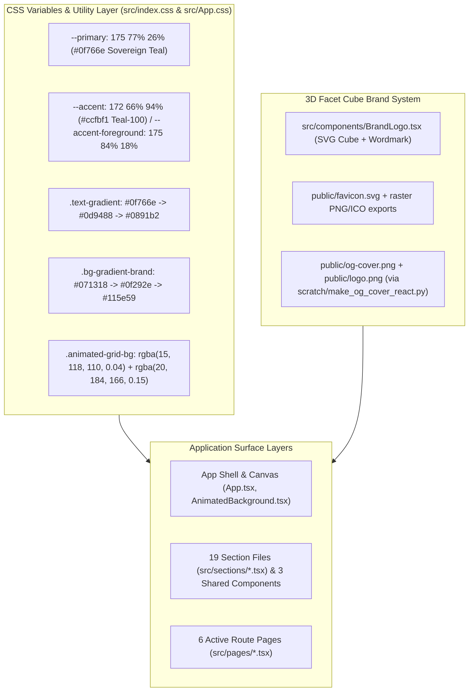

# KaoinAI Website Design Overhaul: Direction 2 (Sovereign Teal & 3D Facet Cube)

*   **Author:** KaoinAI Engineering & Design
*   **Status:** Approved
*   **Date:** 2026-11-02

--------------------------------------------------------------------------------

## Overview

This design specifies a complete visual identity and color system overhaul for the KaoinAI marketing and compliance platform (`I:\kaoinai-website`). It replaces the current purple/violet/indigo color scheme (`#5b2d6e`, `purple-*`, `violet-*`, `fuchsia-*`, `indigo-*`, and lavender page washes) and the mixed crimson-script/purple-wordmark raster logo with **Direction 2**: a **Deep Sovereign Teal (`#0f766e`), Verdigris (`#14b8a6`), and Warm Amber (`#d97706`)** color architecture anchored by a **3D Facet Cube** geometric brand mark across all 19 section files in [`./src/sections/`](file:///I:/kaoinai-website/src/sections), the active route pages in [`./src/pages/`](file:///I:/kaoinai-website/src/pages) (6 route page files with purple/indigo tokens, plus [`./src/pages/Audit.tsx`](file:///I:/kaoinai-website/src/pages/Audit.tsx) and the unmounted Vite starter template [`./src/pages/Home.tsx`](file:///I:/kaoinai-website/src/pages/Home.tsx) which have 0, while the active `/` route is rendered by `function Home()` in [`./src/App.tsx`](file:///I:/kaoinai-website/src/App.tsx)), 4 shared components in [`./src/components/`](file:///I:/kaoinai-website/src/components), global stylesheets ([`./src/index.css`](file:///I:/kaoinai-website/src/index.css), [`./src/App.css`](file:///I:/kaoinai-website/src/App.css)), canvas animations, favicons, and OpenGraph social cards.

--------------------------------------------------------------------------------

## Problem Statement

The current KaoinAI website exhibits three concrete visual and structural weaknesses that undermine its positioning as an enterprise data governance, Singapore PDPA / Malaysia PDPA / Indonesia UU PDP compliance, and MAS TRM cyber hygiene platform:

1.  **Undifferentiated "AI Cliché" Purple Palette**: Across 34 text source/asset files (`src/**/*.tsx`, [`./src/index.css`](file:///I:/kaoinai-website/src/index.css), [`./src/App.css`](file:///I:/kaoinai-website/src/App.css), [`./public/favicon.svg`](file:///I:/kaoinai-website/public/favicon.svg), [`./scratch/make_og_cover_react.py`](file:///I:/kaoinai-website/scratch/make_og_cover_react.py)), there are **490 matching lines containing 797 purple, violet, fuchsia, indigo, and legacy hex/RGB/HSL tokens** (`bg-purple-600`, `text-[#5b2d6e]`, `from-[#fcfbfe] via-[#f8f3fe]/80`, `from-[#1a1a2e] to-[#2d1b4e]`, `via-[#0e0c1f]`, `to-[#8d448b]`, `#646cffaa`, `rgba(147, 51, 234, ...)`, and Pillow RGB tuples). In B2B enterprise software, saturated purple/violet gradients are universally associated with generic consumer LLM wrappers rather than statutory regulatory engineering, banking compliance, and deterministic schema governance.
2.  **Disconnected Brand Mark & Raster Scaling Defects**:
    *   [`./public/logo.png`](file:///I:/kaoinai-website/public/logo.png) combines a 3D bevelled crimson script "K" (`#8b0000`) with a dark purple (`#3b1a54`) "Kaoin" wordmark on a baked-in opaque white rectangle (`1024x559`). Because the white background is baked into the PNG, the logo cannot sit cleanly on translucent glass headers or dark surfaces.
    *   [`./public/favicon.svg`](file:///I:/kaoinai-website/public/favicon.svg) renders an unrelated flat purple/sky-blue neural "K" on a `#0b0816` dark violet square, visually contradicting [`./public/logo.png`](file:///I:/kaoinai-website/public/logo.png).
3.  **Desynchronized CSS Theme Variables & Hardcoded Utility Scales**: In [`./src/index.css`](file:///I:/kaoinai-website/src/index.css), shadcn/ui HSL CSS custom properties (`--primary: 270 45% 30%`, `--ring: 270 45% 30%`, `--accent: 352 75% 45%`) and custom utility classes (`.text-gradient`, `.bg-gradient-brand`, `.animated-grid-bg`) are locked to purple/crimson, while React components use Tailwind's full `purple-50..950`, `violet-*`, and `indigo-*` utility scales for multi-stop gradients, translucent glass borders, and dark telemetry consoles. Both layers must be updated in lockstep to establish a cohesive, contrast-compliant palette.

--------------------------------------------------------------------------------

## Proposed Solution

We will execute a systematic transition to **Direction 2 (Sovereign Teal, Verdigris, Warm Amber, and Crisp Alabaster/Slate)** paired with a **3D Facet Cube** vector brand mark:

*   **Color System**: Replace all 797 purple/violet/fuchsia/indigo/legacy tokens across all 490 matching lines in 34 modified files with a structured four-tier palette:
    1.  **Primary Structural Brand (Deep Sovereign Teal)**: `teal-700` (`#0f766e`) and `teal-800` (`#115e59`) for primary buttons, active tabs, and high-contrast headings/links on light backgrounds (WCAG 2.1 AA contrast $\ge 5.44:1$ on white).
    2.  **Luminous Midtone & Interactive Highlights (Verdigris / Cyan-Teal)**: `teal-600` (`#0d9488`), `teal-500` (`#14b8a6`), and `cyan-600` (`#0891b2`) for non-text SVG icons ($\ge 3.68:1$ passing WCAG 1.4.11 non-text contrast), gradient stops, dark-console borders, vector lineage links, and 3D cube sunlit facets.
    3.  **Secondary Telemetry & Attention Accent (Warm Amber / Gold)**: `amber-800` (`#92400e`, `7.0:1` on light surfaces), `amber-500` (`#f59e0b`), and `amber-300` (`#fcd34d`, on dark consoles) for DPIA drift callouts, MDM match highlights, and cube core vertex accents—preventing visual collision with semantic green (`emerald-500` live status) and semantic red (`rose-500` / `red-500` risk/violation states).
    4.  **Neutral Architectural Surfaces (Alabaster & Deep Obsidian-Teal)**: `#f8fafc` (`slate-50`) and `#f0fdfa` (`teal-50/50`) for light page washes; `#071318` to `#0f172a` (`slate-900`) for dark telemetry consoles.
*   **3D Facet Cube Brand Mark**: Replace the crimson script "K" and purple wordmark with a multi-faceted isometric 3D polyhedral cube representing structured, immutable data blocks and multi-dimensional lineage:
    *   **Top Sunlit Facet**: Verdigris / Electric Teal plane (`#5eead4` to `#0d9488`), subdivided into 4 crystalline geometric triangles meeting at a raised 3D peak $F_T(50, 26)$.
    *   **Left Midtone Facet**: Sovereign Teal plane (`#0d9488` to `#134e4a`), subdivided into 4 triangles meeting at a displaced 3D peak $F_L(29, 62)$.
    *   **Right Shadow Facet**: Deep Obsidian Slate-Cyan plane (`#0e7490` to `#091318`), subdivided into 4 triangles meeting at a displaced 3D peak $F_R(71, 62)$, with a Warm Amber (`#f59e0b`) faceted diamond node at the central convergence vertex $V_C(50, 50)$.
    *   Delivered as a reusable React SVG component ([`./src/components/BrandLogo.tsx`](file:///I:/kaoinai-website/src/components/BrandLogo.tsx) exporting `FacetCubeMark` and `BrandLogo`) plus synchronized static assets ([`./public/favicon.svg`](file:///I:/kaoinai-website/public/favicon.svg), [`./public/favicon-32x32.png`](file:///I:/kaoinai-website/public/favicon-32x32.png), [`./public/apple-touch-icon.png`](file:///I:/kaoinai-website/public/apple-touch-icon.png), [`./public/favicon.ico`](file:///I:/kaoinai-website/public/favicon.ico), [`./public/logo.png`](file:///I:/kaoinai-website/public/logo.png), [`./public/og-cover.png`](file:///I:/kaoinai-website/public/og-cover.png)).

--------------------------------------------------------------------------------

## Goals

*   **Zero Purple/Violet/Indigo Residue**: Eliminate 100% of `purple-*`, `violet-*`, `fuchsia-*`, `indigo-*`, `#5b2d6e`, `#7c3aed`, `#9333ea`, `#a855f7`, `#c084fc`, `#1e1b4b`, `#312e81`, `#fcfbfe`, `#f8f3fe`, `#0b0816`, `#4f46e5`, `#2d1b4e`, `#1a1a2e`, `#0e0c1f`, `#8d448b`, `#646cffaa`, and legacy purple RGB/HSL occurrences across all files in `src/`, `public/`, [`./index.html`](file:///I:/kaoinai-website/index.html), and [`./scratch/make_og_cover_react.py`](file:///I:/kaoinai-website/scratch/make_og_cover_react.py) (verified via automated recursive grep gate returning `0` matches).
*   **Unified 3D Facet Cube Brand Identity**: Render the 3D Facet Cube mark and updated Slate/Teal wordmark consistently across [`./src/sections/Navigation.tsx`](file:///I:/kaoinai-website/src/sections/Navigation.tsx), [`./src/sections/Footer.tsx`](file:///I:/kaoinai-website/src/sections/Footer.tsx), [`./public/favicon.svg`](file:///I:/kaoinai-website/public/favicon.svg), [`./public/favicon.ico`](file:///I:/kaoinai-website/public/favicon.ico), [`./public/favicon-32x32.png`](file:///I:/kaoinai-website/public/favicon-32x32.png), [`./public/apple-touch-icon.png`](file:///I:/kaoinai-website/public/apple-touch-icon.png), [`./public/logo.png`](file:///I:/kaoinai-website/public/logo.png), and [`./public/og-cover.png`](file:///I:/kaoinai-website/public/og-cover.png).
*   **Semantic Token & WCAG 2.1 AA Contrast Compliance**: Update CSS custom properties in [`./src/index.css`](file:///I:/kaoinai-website/src/index.css) (`--primary`, `--ring`, `--accent`, `--accent-foreground`, `--sidebar-*`) and utility classes (`.text-gradient`, `.bg-gradient-brand`, `.animated-grid-bg`) to the Direction 2 Sovereign Teal & Amber palette, maintaining WCAG 2.1 AA contrast ratios ($\ge 4.5:1$ for normal text, $\ge 3.0:1$ for large text and non-text UI components/icons).
*   **Zero Performance Regression**: Maintain 60fps canvas rendering in [`./src/components/AnimatedBackground.tsx`](file:///I:/kaoinai-website/src/components/AnimatedBackground.tsx) and zero bundle-size bloat by building the 3D Facet Cube in pure vector SVG rather than importing heavy WebGL/Three.js libraries.

--------------------------------------------------------------------------------

## Non-Goals

*   **Copywriting or Product Positioning Changes**: We are not rewriting the statutory compliance claims (SG PDPA, MY PDPA, ID UU PDP, MAS TRM), pricing tiers, or blog article prose.
*   **Heavy 3D WebGL Runtime Dependencies**: We will not add `three`, `@react-three/fiber`, or external `.glb`/`.gltf` model loaders that would degrade Largest Contentful Paint (LCP) or mobile GPU battery life.
*   **Surface Polarity Inversion**: Light-mode sections (including [`./src/components/AnnouncementBar.tsx`](file:///I:/kaoinai-website/src/components/AnnouncementBar.tsx) and [`./src/sections/CTA.tsx`](file:///I:/kaoinai-website/src/sections/CTA.tsx)) remain light-mode surfaces, while existing dark-mode interactive consoles (the right-column telemetry console in [`./src/sections/Hero.tsx`](file:///I:/kaoinai-website/src/sections/Hero.tsx), the dark stage in [`./src/sections/ProductShowcase.tsx`](file:///I:/kaoinai-website/src/sections/ProductShowcase.tsx), the dark terminal in [`./src/sections/InteractiveDemo.tsx`](file:///I:/kaoinai-website/src/sections/InteractiveDemo.tsx), the metrics bar in [`./src/components/TrustedBy.tsx`](file:///I:/kaoinai-website/src/components/TrustedBy.tsx), the impact card in [`./src/sections/RoiCalculator.tsx`](file:///I:/kaoinai-website/src/sections/RoiCalculator.tsx), and the dark callout banners in [`./src/pages/BlogIndex.tsx`](file:///I:/kaoinai-website/src/pages/BlogIndex.tsx), [`./src/pages/BlogPost.tsx`](file:///I:/kaoinai-website/src/pages/BlogPost.tsx), and [`./src/pages/SecurityOverview.tsx`](file:///I:/kaoinai-website/src/pages/SecurityOverview.tsx)) remain dark-mode surfaces.

--------------------------------------------------------------------------------

## Open Questions

*   *None; palette architecture (Option B: Deep Sovereign Teal, Verdigris & Warm Amber) and 3D Facet Cube scope (Brand Mark + Site-wide Palette Overhaul) are locked.*

--------------------------------------------------------------------------------

## Critical User Journeys (CUJs)

### CUJ 1: First-Impression Brand & Hero Pillar Exploration

*   **Given**: A first-time enterprise visitor or compliance officer loads `https://kaoinai.com/` on desktop or mobile.
*   **When**: The Navigation bar, Hero section, AnimatedBackground canvas, and synchronized right-hand Telemetry Console render and the user switches between the 4 Hero pillar tabs (*Data Governance for AI*, *Living Data Inventory (RoPA)*, *Enterprise Data Governance*, *Master Data & Quality*).
*   **Then**:
    *   The Navigation bar displays the crisp SVG **3D Facet Cube** mark alongside the `KaoinAI` wordmark (deep slate `Kaoin` + sovereign teal `AI`) with zero white-box raster artifacts.
    *   The background canvas drifts Sovereign Teal (`15, 118, 110`), Verdigris (`20, 184, 166`), Cyan (`8, 145, 178`), Emerald (`16, 185, 129`), and Warm Amber (`217, 119, 6`) nodes connected by subtle teal constellation lines (`rgba(13, 148, 136, alpha)`).
    *   Active pillar tabs, badges, primary CTAs, and the dark telemetry console use Sovereign Teal, Verdigris, and Warm Amber accents with zero purple or indigo hues.

### CUJ 2: Interactive Product Tour, Live Demo & Maturity Audit

*   **Given**: A technical evaluator scrolls through `#product-tour` ([`./src/sections/ProductShowcase.tsx`](file:///I:/kaoinai-website/src/sections/ProductShowcase.tsx)), `#demo` ([`./src/sections/InteractiveDemo.tsx`](file:///I:/kaoinai-website/src/sections/InteractiveDemo.tsx)), and `#audit` ([`./src/sections/MaturityRiskAudit.tsx`](file:///I:/kaoinai-website/src/sections/MaturityRiskAudit.tsx) or `/audit`).
*   **When**: The user clicks through the 4 Product Tour tabs (*Column-Level Lineage*, *Table-Bound DPIA & RoPA*, *Ask Data SQL Studio*, *MDM Golden Records*), explores the 5 scenario cards and 3 view tabs (`insights`, `sql`, `lineage`) in the Interactive Demo, and completes the Maturity & Risk Audit questionnaire.
*   **Then**:
    *   Selected tour cards and active interactive controls highlight in Sovereign Teal (`bg-teal-700`, `border-teal-700`, `ring-teal-300`) with high-contrast active badges (`bg-teal-800 text-white`).
    *   Semantic status colors remain unambiguous: Emerald (`emerald-500`) exclusively denotes verified/healthy compliance, Warm Amber (`amber-500`/`amber-800`) denotes medium drift/attention, and Rose/Red (`rose-500`) denotes critical PII exposure or statutory violation.

### CUJ 3: Social Sharing, Browser Tab & PWA Installation

*   **Given**: A user shares a KaoinAI URL on LinkedIn/Slack/WhatsApp or bookmarks the site on desktop/iOS.
*   **When**: The browser or social crawler fetches `/favicon.svg`, `/favicon-32x32.png`, `/apple-touch-icon.png`, `/logo.png`, and `/og-cover.png`.
*   **Then**: All icons and the `1200x630` OpenGraph card display the 3D Facet Cube brand mark and Sovereign Teal / Slate visual identity, with zero legacy crimson-script or purple artifacts.

--------------------------------------------------------------------------------

## Technical Plan (Architecture)

### 1. Color Token & CSS Architecture (Direction 2: Sovereign Teal, Verdigris & Warm Amber)

To eliminate all 797 purple/violet/fuchsia/indigo/legacy tokens across 490 matching lines in 34 modified files without leaving any design decisions to the implementer, the color architecture updates [`./src/index.css`](file:///I:/kaoinai-website/src/index.css) and [`./src/App.css`](file:///I:/kaoinai-website/src/App.css) and applies a strict **1:1 Default Token Substitution Table** across all source files, supplemented only by explicit line-level overrides documented per file.



#### Deterministic 1:1 Default Token Substitution Table

Unless an explicit line-level override is specified for a file in the Detailed Implementation Plan, every legacy token in `src/**/*.tsx` maps 1:1 by family and shade as follows (preserving any prefix such as `hover:`, `group-hover:`, `focus:`, `focus-visible:`, `selection:`, `placeholder:`, `from-`, `via-`, `to-`, `bg-`, `text-`, `border-`, `ring-`, `shadow-`, `decoration-`, `accent-`, `fill-`, and preserving any opacity suffix such as `/10`, `/20`, `/40`, `/50`, `/70`, `/80`):

| Legacy Token Family / Hex | Deterministic 1:1 Default Replacement | Hex / Contrast Verification |
| :--- | :--- | :--- |
| **`purple-50` / `violet-50`** | `teal-50` | `#f0fdfa` (Cool verdigris-alabaster surface tint) |
| **`purple-100` / `violet-100`** | `teal-100` | `#ccfbf1` (Light badge & pill fill) |
| **`purple-200` / `violet-200`** | `teal-200` | `#99f6e4` (Light border & dark-console high-luminance text) |
| **`purple-300` / `violet-300`** | `teal-300` | `#5eead4` (Hover border & dark-console badge text) |
| **`purple-400` / `violet-400`** | `teal-400` (exception on light `bg-white` inputs: `text-purple-400` $\rightarrow$ `text-teal-600`; `placeholder:text-purple-400/70` $\rightarrow$ `placeholder:text-slate-400`) | `#2dd4bf` for focus rings & dark consoles; `#0d9488` (`3.74:1`) for input icons on white; `#94a3b8` for input placeholders |
| **`purple-500` / `violet-500`** | `teal-500` (exception: `bg-purple-500` active tab badge $\rightarrow$ `bg-teal-800` in [`ProductShowcase.tsx` L88](file:///I:/kaoinai-website/src/sections/ProductShowcase.tsx#L88); `hover:bg-purple-500` on `text-white` buttons $\rightarrow$ `hover:bg-teal-800`; `text-purple-500` on light surface $\rightarrow$ `text-teal-700`, with explicit icon override `text-teal-600` in [`Footer.tsx` L71, L77, L83](file:///I:/kaoinai-website/src/sections/Footer.tsx#L71-L83)) | `#14b8a6` for gradients/borders/rings; `#0f766e` (`5.44:1`) for light text; `#115e59` (`7.23:1`) for active badge & solid button hover |
| **`purple-600` / `violet-600`** | `teal-700` for all `bg-purple-600` and `text-purple-600` occurrences by default; `teal-600` for `from-purple-600`, `via-purple-600`, `to-purple-600`, `border-purple-600`, `bg-purple-600/*`, and explicit icon overrides ([`AnnouncementBar.tsx` L30](file:///I:/kaoinai-website/src/components/AnnouncementBar.tsx#L30), [`Hero.tsx` L274](file:///I:/kaoinai-website/src/sections/Hero.tsx#L274)) | `#0f766e` (`5.44:1` on white, `4.51:1` on `bg-teal-100` icon containers); `#0d9488` (`3.74:1` non-text icon/border contrast) |
| **`purple-700` / `violet-700`** | `teal-800` for `hover:bg-purple-700` and `text-purple-700`; `teal-700` for `bg-purple-700`, `hover:text-purple-700`, `group-hover:text-purple-700`, `hover:decoration-purple-700` | `#115e59` (`7.23:1` on white) and `#0f766e` (`5.44:1` on white) |
| **`purple-800` / `violet-800`** | `teal-800` (`border-purple-800/40` $\rightarrow$ `border-teal-800/40`) | `#115e59` (`7.23:1` contrast on white) |
| **`purple-900` / `violet-900`** | `teal-900` (`#134e4a`, `9.41:1` on white) | High-contrast body/badge text & dark console tint |
| **`purple-950` / `violet-950`** | `teal-950` (`#042f2e`, `14.8:1` on white) | Deepest obsidian-teal shadow/surface |
| **`indigo-50` .. `indigo-950`** | `cyan-50` .. `cyan-950` of the exact same shade number (e.g., `via-indigo-50/70` $\rightarrow$ `via-cyan-50/70`, `to-indigo-600` $\rightarrow$ `to-cyan-600`, `via-indigo-950` $\rightarrow$ `via-cyan-950`, `text-indigo-400` $\rightarrow$ `text-cyan-400`, `bg-indigo-100` $\rightarrow$ `bg-cyan-100`, `text-indigo-700` $\rightarrow$ `text-cyan-700`; exception: `text-indigo-600` on light surface $\rightarrow$ `text-cyan-700`) | Harmonizes secondary gradient stops and badges into Cyan-Teal with zero blue-violet residue |
| **`#5b2d6e` (Legacy Brand Hex)** | `bg-[#5b2d6e]` $\rightarrow$ `bg-teal-700`; `bg-[#5b2d6e]/10` $\rightarrow$ `bg-teal-700/10`; `border-[#5b2d6e]` $\rightarrow$ `border-teal-700`; `border-[#5b2d6e]/20` $\rightarrow$ `border-teal-700/20`; `ring-[#5b2d6e]/20` $\rightarrow$ `ring-teal-700/20`; `text-[#5b2d6e]` $\rightarrow$ `text-teal-800`; `text-[#5b2d6e]/40` $\rightarrow$ `text-teal-800/40`; `selection:text-[#5b2d6e]` $\rightarrow$ `selection:text-teal-900`; `accent-[#5b2d6e]` $\rightarrow$ `accent-teal-700`; `from-[#5b2d6e]` $\rightarrow$ `from-teal-700` | Replaces all 54 raw `#5b2d6e` occurrences across all utility variants with standard Tailwind `teal-700`/`teal-800`/`teal-900` tokens |
| **`#7c3aed` (Legacy Violet Hex)** | `text-[#7c3aed]` $\rightarrow$ `text-teal-600` (used on `<Sparkles size={14} />` in [`Hero.tsx` L229](file:///I:/kaoinai-website/src/sections/Hero.tsx#L229)) | `#0d9488` (`3.74:1` non-text icon contrast) |
| **`#0b0816` / `#0e0c1f` / `#1a1a2e` / `#2d1b4e`** | `#0b0816` $\rightarrow$ `#071318`; `#0e0c1f` $\rightarrow$ `#09191f`; `from-[#1a1a2e] to-[#2d1b4e]` $\rightarrow$ `from-[#091519] to-[#0f292e]` | Deep obsidian-teal dark console & card surfaces |
| **`#8d448b` (Legacy Orchid Hex)** | `to-[#8d448b]` $\rightarrow$ `to-cyan-700` (in [`Contact.tsx` L421](file:///I:/kaoinai-website/src/pages/Contact.tsx#L421) avatar gradient) | Pairs with `from-teal-700` |
| **`#fcfbfe` & `#f8f3fe`** | `from-[#fcfbfe] via-[#f8f3fe]/80 to-[#fcfbfe]` $\rightarrow$ `from-[#f8fafc] via-[#f0fdfa]/50 to-[#f8fafc]` | Alabaster slate & subtle verdigris page wash |

### 2. 3D Facet Cube Geometry & Brand Component ([`./src/components/BrandLogo.tsx`](file:///I:/kaoinai-website/src/components/BrandLogo.tsx))

To eliminate the opaque white bounding box of the legacy `1024x559` [`./public/logo.png`](file:///I:/kaoinai-website/public/logo.png) and unify the brand mark across [`./src/sections/Navigation.tsx`](file:///I:/kaoinai-website/src/sections/Navigation.tsx), [`./src/sections/Footer.tsx`](file:///I:/kaoinai-website/src/sections/Footer.tsx), and all static icons, we create [`./src/components/BrandLogo.tsx`](file:///I:/kaoinai-website/src/components/BrandLogo.tsx).

#### Geometric Construction of the 3D Facet Cube (`viewBox="0 0 100 100"`)

The 3D Facet Cube is an isometric hexagonal polyhedron centered at `(50, 50)` with outer vertices:
*   **Top Peak ($V_T$)**: `(50, 8)`
*   **Upper Right ($V_{UR}$)**: `(86, 29)`
*   **Lower Right ($V_{LR}$)**: `(86, 71)`
*   **Bottom Peak ($V_B$)**: `(50, 92)`
*   **Lower Left ($V_{LL}$)**: `(14, 71)`
*   **Upper Left ($V_{UL}$)**: `(14, 29)`
*   **Center Core ($V_C$)**: `(50, 50)`

To prevent sub-pixel anti-aliasing seams between abutting SVG polygons at small sizes (`16px`–`36px`) and to create genuine 3D polyhedral facet angles (rather than flat collinear diagonals), `FacetCubeMark` renders:
1.  **Solid Backing Hexagon (Anti-Seam Base Layer)**:
    *   `<polygon points="50,8 86,29 86,71 50,92 14,71 14,29" fill="#0f766e" />`
2.  **Top Face (Sunlit Verdigris Plane)** — subdivided around outward-displaced 3D peak $F_T(50, 26)$:
    *   North-West Triangle: `<polygon points="50,8 50,26 14,29" fill="#5eead4" />` (`teal-300`)
    *   North-East Triangle: `<polygon points="50,8 86,29 50,26" fill="#2dd4bf" />` (`teal-400`)
    *   South-West Triangle: `<polygon points="14,29 50,26 50,50" fill="#14b8a6" />` (`teal-500`)
    *   South-East Triangle: `<polygon points="50,26 86,29 50,50" fill="#0d9488" />` (`teal-600`)
3.  **Left Face (Midtone Sovereign Teal Plane)** — subdivided around outward-displaced 3D peak $F_L(29, 62)$:
    *   Upper-Inner Triangle: `<polygon points="14,29 50,50 29,62" fill="#0d9488" />` (`teal-600`)
    *   Upper-Outer Triangle: `<polygon points="14,29 29,62 14,71" fill="#0f766e" />` (`teal-700`)
    *   Lower-Inner Triangle: `<polygon points="50,50 50,92 29,62" fill="#115e59" />` (`teal-800`)
    *   Lower-Outer Triangle: `<polygon points="29,62 50,92 14,71" fill="#134e4a" />` (`teal-900`)
4.  **Right Face (Shadow Obsidian-Slate & Cyan Plane)** — subdivided around outward-displaced 3D peak $F_R(71, 62)$:
    *   Upper-Inner Triangle: `<polygon points="50,50 86,29 71,62" fill="#0e7490" />` (`cyan-700`)
    *   Upper-Outer Triangle: `<polygon points="86,29 86,71 71,62" fill="#155e75" />` (`cyan-800`)
    *   Lower-Inner Triangle: `<polygon points="50,50 71,62 50,92" fill="#0f172a" />` (`slate-900`)
    *   Lower-Outer Triangle: `<polygon points="71,62 86,71 50,92" fill="#071318" />` (deep obsidian-teal)
5.  **Facet Ridge Lines & Central Warm Amber Core Vertex ($V_C$)**:
    *   Primary Y-junction crease lines (`(14, 29)` $\rightarrow$ `(50, 50)` $\rightarrow$ `(86, 29)` and `(50, 50)` $\rightarrow$ `(50, 92)`): `<path d="M14 29 L50 50 L86 29 M50 50 L50 92" stroke="#99f6e4" strokeOpacity="0.45" strokeWidth="1.2" fill="none" />`
    *   Sub-facet ridge lines connecting $F_T(50, 26)$, $F_L(29, 62)$, and $F_R(71, 62)$ to their face corners: `<path d="M50 8 L50 26 M14 29 L50 26 L86 29 M50 26 L50 50 M14 29 L29 62 L50 50 M14 71 L29 62 L50 92 M86 29 L71 62 L50 50 M86 71 L71 62 L50 92" stroke="#ffffff" strokeOpacity="0.18" strokeWidth="0.85" fill="none" />`
    *   Central Warm Amber Core Glow Ring: `<circle cx="50" cy="50" r="10" fill="none" stroke="#fbbf24" strokeOpacity="0.35" strokeWidth="1.2" />`
    *   Central Warm Amber Faceted Diamond Node: `<polygon points="50,43 57,50 50,57 43,50" fill="#f59e0b" stroke="#fef3c7" strokeWidth="1.2" />`

#### `BrandLogo` Component Signature & Lockup

*   **Props Interface**:
    ```ts
    export interface BrandLogoProps {
      variant?: 'light' | 'dark'
      showTagline?: boolean
      className?: string
    }
    ```
*   **Markup Structure**:
    *   Renders `<span className={cn("inline-flex items-center gap-2.5 select-none", className)}>`
    *   Left icon: `<FacetCubeMark className="w-8 h-8 sm:w-9 sm:h-9 shrink-0" />`
    *   Right text column (`flex flex-col leading-none`):
        *   Wordmark row (`text-xl sm:text-2xl font-extrabold tracking-tight`): `<span className={variant === 'dark' ? 'text-white' : 'text-slate-900'}>Kaoin</span><span className="text-gradient">AI</span>`
        *   Optional tagline (`showTagline && <span className="text-[10px] font-medium tracking-wider uppercase text-slate-500 mt-0.5">Empowering through AI</span>`)
*   **Static Asset Pipeline ([`./scratch/make_og_cover_react.py`](file:///I:/kaoinai-website/scratch/make_og_cover_react.py))**:
    *   Extend [`./scratch/make_og_cover_react.py`](file:///I:/kaoinai-website/scratch/make_og_cover_react.py) (which uses Python `PIL.Image`, `PIL.ImageDraw`, `PIL.ImageFilter`, `PIL.ImageFont`) to draw the exact 12-facet cube polygon coordinates supersampled at `4x` resolution and downsampled via `Image.Resampling.LANCZOS`, generating in order:
        1.  [`./public/favicon-32x32.png`](file:///I:/kaoinai-website/public/favicon-32x32.png) (`32x32` PNG with `#071318` dark rounded-rect background)
        2.  [`./public/apple-touch-icon.png`](file:///I:/kaoinai-website/public/apple-touch-icon.png) (`180x180` PNG with `#071318` dark rounded-rect background)
        3.  [`./public/favicon.ico`](file:///I:/kaoinai-website/public/favicon.ico) (multi-size `16x16`, `32x32`, `48x48` ICO with `#071318` dark rounded-rect background)
        4.  [`./public/logo.png`](file:///I:/kaoinai-website/public/logo.png) (`1024x559` transparent-background RGBA PNG featuring the 3D Facet Cube + `KaoinAI` wordmark, preserving exact dimensional compatibility with [`./public/manifest.json`](file:///I:/kaoinai-website/public/manifest.json) Line 22)
        5.  [`./public/og-cover.png`](file:///I:/kaoinai-website/public/og-cover.png) (`1200x630` Direction 2 OpenGraph social card compositing the newly generated transparent `logo.png` onto a white rounded-rectangle chip via `Image.alpha_composite` without overwriting alpha via `putalpha`)

### 3. Canvas Constellation & Cursor Spotlight ([`./src/components/AnimatedBackground.tsx`](file:///I:/kaoinai-website/src/components/AnimatedBackground.tsx))

The background canvas runs a 60fps `requestAnimationFrame` loop with zero DOM blur filters:
*   **Particle Palette Array (`colorPalettes` at Lines 74–80, updating both RGB strings and inline comments)**:
    *   `'15, 118, 110'` (`// teal-700`)
    *   `'20, 184, 166'` (`// teal-500`)
    *   `'8, 145, 178'` (`// cyan-600`)
    *   `'16, 185, 129'` (`// emerald-500`)
    *   `'217, 119, 6'` (`// amber-600`)
*   **Cursor Radial Gradients (Lines 124–141)**:
    *   Outer spotlight (`glowGrad`): stop `0` `rgba(20, 184, 166, ${0.14 * mouse.currentOpacity})`, stop `0.35` `rgba(15, 118, 110, ${0.07 * mouse.currentOpacity})`, stop `0.65` `rgba(8, 145, 178, ${0.03 * mouse.currentOpacity})`, stop `1` `'transparent'`.
    *   Inner core (`coreGrad`): stop `0` `rgba(45, 212, 191, ${0.22 * mouse.currentOpacity})`, stop `0.5` `rgba(15, 118, 110, ${0.09 * mouse.currentOpacity})`, stop `1` `'transparent'`.
*   **Constellation Link Stroke (Line 216)**: `rgba(13, 148, 136, ${linkAlpha})` (`teal-600`).
*   **Static Ambient Radial Divs (Lines 254–271)**:
    *   Top-right div (Line 257): `'radial-gradient(circle, rgba(20, 184, 166, 0.11) 0%, rgba(15, 118, 110, 0.05) 45%, transparent 70%)'`
    *   Middle-left div (Line 263): `'radial-gradient(circle, rgba(8, 145, 178, 0.09) 0%, rgba(15, 118, 110, 0.04) 45%, transparent 70%)'`
    *   Bottom-right div (Line 269): `'radial-gradient(circle, rgba(217, 119, 6, 0.07) 0%, rgba(16, 185, 129, 0.04) 45%, transparent 70%)'`

--------------------------------------------------------------------------------

## Alternatives Considered

### Alternative A: Cobalt, Electric Cyan & Emerald Palette

*   **Pros**: Signals traditional cloud infrastructure and banking security; high familiarity across enterprise software.
*   **Cons**: Visually blends into generic B2B SaaS templates (Stripe/Jira/Cloudflare clones) and lacks a distinctive brand signature for "Living Data Inventory" and autonomous governance. Light cyan text (`#0ea5e9`) also fails WCAG AA contrast on white backgrounds unless darkened to navy/sky-800.
*   **Reason for Rejection**: Rejected in favor of Option B (Deep Sovereign Teal `#0f766e`, Verdigris `#14b8a6`, and Warm Amber `#d97706`), which differentiates KaoinAI from both the "AI purple" cliché and generic corporate blue.

### Alternative B: Obsidian Slate, Crimson-Ruby & Titanium (Preserving Original Logo "K" Red)

*   **Pros**: Maintains visual continuity with the deep crimson/maroon script "K" in the legacy [`./public/logo.png`](file:///I:/kaoinai-website/public/logo.png) while removing purple.
*   **Cons**: Crimson/ruby accents across badges, charts, and interactive cards collide with semantic error/violation states (`rose-500` / `red-600`) used in the Table-Bound DPIA risk scanner and Maturity Risk Audit. Enterprise compliance officers associate red UI highlights with statutory breaches or broken pipelines.
*   **Reason for Rejection**: Rejected because semantic clarity between brand accents (Teal/Amber) and compliance risk alerts (Red/Rose) is mandatory in a governance platform.

### Alternative C: WebGL / Three.js Interactive 3D Facet Cube Runtime

*   **Pros**: Allows real-time quaternion rotation, dynamic point-light shaders, and cursor-driven 3D camera orbit on the Facet Cube.
*   **Cons**: Adds ~150KB+ gzipped JavaScript (`three` + `@react-three/fiber`), increases Total Blocking Time (TBT) and Largest Contentful Paint (LCP), and competes with [`./src/components/AnimatedBackground.tsx`](file:///I:/kaoinai-website/src/components/AnimatedBackground.tsx) for GPU rasterization budget on mobile and integrated-GPU laptops.
*   **Reason for Rejection**: Rejected in favor of a pure 12-facet isometric SVG polyhedral component ([`./src/components/BrandLogo.tsx`](file:///I:/kaoinai-website/src/components/BrandLogo.tsx)) with displaced 3D face peaks, achieving 3D faceted depth at `< 2KB` with zero WebGL runtime overhead.

--------------------------------------------------------------------------------

## Risks & Mitigations

### Risk 1: Sub-Pixel SVG Anti-Aliasing Seams Across the 12 Micro-Facets

*   **Risk**: When 12 abutting SVG `<polygon>` triangles share edge coordinates at small rendering sizes (`16px`–`36px` in the navbar or favicon), browser GPU rasterizers can leak 1px background hairlines between adjacent polygons.
*   **Mitigation**: Render a solid outer backing hexagon (`<polygon points="50,8 86,29 86,71 50,92 14,71 14,29" fill="#0f766e" />`) underneath the 12 micro-facets and overlay explicit `<path>` ridge strokes along the facet seams.

### Risk 2: WCAG 2.1 AA Contrast Regressions on Midtone Teal/Amber Utilities & Shadcn Hover States

*   **Risk**: Using `text-teal-600` (`#0d9488`, `3.74:1`) or `text-amber-600` (`#d97706`, `3.19:1`) for normal text on white surfaces, using `bg-teal-500 text-white` (`2.49:1`) on small badges, using `hover:bg-teal-600` (`3.74:1`) on solid white-text buttons, or setting `--accent` to dark amber (which turns shadcn `<Button variant="outline">` hover backgrounds dark amber with low-contrast white text) fails WCAG 2.1 AA ($\ge 4.5:1$).
*   **Mitigation**: Enforce `text-teal-700` (`5.44:1`) / `text-teal-800` (`7.23:1`) and `text-amber-800` (`7.0:1`) for all normal text on light surfaces; map solid `bg-teal-700 text-white` button hovers to `hover:bg-teal-800` (`7.23:1`); use `bg-teal-800 text-white` (`7.23:1`) on active badges inside active tabs; and set `--accent: 172 66% 94%` (`teal-100`) with `--accent-foreground: 175 84% 18%` (`teal-900`) in [`./src/index.css`](file:///I:/kaoinai-website/src/index.css).

### Risk 3: Accidental Dark-on-Dark Contrast from Surface Polarity Flipping

*   **Risk**: Flipping light-mode components such as [`./src/components/AnnouncementBar.tsx`](file:///I:/kaoinai-website/src/components/AnnouncementBar.tsx) or [`./src/sections/CTA.tsx`](file:///I:/kaoinai-website/src/sections/CTA.tsx) to dark backgrounds while leaving their internal `text-slate-700`/`text-slate-800` copy untouched produces unreadable `1.3:1` dark-on-dark text.
*   **Mitigation**: Strictly preserve existing surface polarity across all components ([`./src/components/AnnouncementBar.tsx`](file:///I:/kaoinai-website/src/components/AnnouncementBar.tsx) and [`./src/sections/CTA.tsx`](file:///I:/kaoinai-website/src/sections/CTA.tsx) remain light-mode surfaces with `teal-50`/`cyan-50` washes).

### Risk 4: Tailwind JIT Dynamic Class Scanning

*   **Risk**: Constructing Tailwind utility classes dynamically via string interpolation (e.g., `` `text-${color}-700` ``) prevents Tailwind's JIT scanner from emitting the CSS rule.
*   **Mitigation**: Write all replacement Tailwind classes as complete static string literals in JSX and configuration arrays (`heroMessages`, `features`, `tabs`), verified via `npm run build` and computed DOM style checks.

--------------------------------------------------------------------------------

## Non-Functional Requirements

*   **Accessibility & Contrast (WCAG 2.1 AA)**:
    *   Primary buttons (`bg-teal-700` `#0f766e` with `#ffffff` text, hovering to `hover:bg-teal-800` `#115e59`) maintain `5.44:1` resting and `7.23:1` hover contrast (exceeding the `4.5:1` AA minimum).
    *   Inline text accents on light backgrounds (`#ffffff` or `#f8fafc`) use `text-teal-800` (`#115e59`, `7.23:1`) or `text-teal-700` (`#0f766e`, `5.44:1`), never `text-teal-400`, `text-teal-500`, or `text-teal-600`.
    *   Warm Amber text on light backgrounds uses `text-amber-800` (`#92400e`, `7.0:1`) or `text-amber-900` (`#78350f`), reserving `text-amber-300` / `text-amber-400` strictly for dark console surfaces (`#071318` / `slate-950`).
*   **Performance & Bundle Size**:
    *   Zero new npm runtime dependencies added to [`./package.json`](file:///I:/kaoinai-website/package.json).
    *   Replacing the `1024x559` raster `logo.png` in [`./src/sections/Navigation.tsx`](file:///I:/kaoinai-website/src/sections/Navigation.tsx) and [`./src/sections/Footer.tsx`](file:///I:/kaoinai-website/src/sections/Footer.tsx) with the inline SVG `BrandLogo` component eliminates an HTTP image request on critical path rendering.
*   **SEO & Metadata Continuity**:
    *   [`./public/logo.png`](file:///I:/kaoinai-website/public/logo.png) (`1024x559`) and [`./public/og-cover.png`](file:///I:/kaoinai-website/public/og-cover.png) (`1200x630`) are regenerated and served at their exact canonical paths and dimensions so [`./index.html`](file:///I:/kaoinai-website/index.html) JSON-LD (`https://kaoinai.com/logo.png`), [`./public/manifest.json`](file:///I:/kaoinai-website/public/manifest.json), and OpenGraph crawlers never encounter a 404, dimension mismatch, or stale purple artwork.

--------------------------------------------------------------------------------

## Detailed Implementation Plan

The implementation is partitioned into **4 incremental phases** covering 1 newly created file and 34 modified files (`490` matching lines, `797` tokens). After each phase, the codebase must compile cleanly (`npm run build`) and pass that phase's scoped zero-purple grep check before advancing.

### Phase 1: Brand Component, Static Assets & Global CSS Tokens

#### 1. [`./src/components/BrandLogo.tsx`](file:///I:/kaoinai-website/src/components/BrandLogo.tsx) (Create)

*   **Type / Scope**: React TypeScript SVG Brand Component
*   **Proposed Changes**:
    *   Create [`./src/components/BrandLogo.tsx`](file:///I:/kaoinai-website/src/components/BrandLogo.tsx) exporting `BrandLogoProps` (`variant?: 'light' | 'dark'`, `showTagline?: boolean`, `className?: string`), `FacetCubeMark`, and default `BrandLogo`.
    *   `FacetCubeMark` renders `<svg viewBox="0 0 100 100" shapeRendering="geometricPrecision">` containing the solid backing hexagon (`points="50,8 86,29 86,71 50,92 14,71 14,29" fill="#0f766e"`), the 12 triangular micro-facets meeting at displaced 3D peaks $F_T(50, 26)$, $F_L(29, 62)$, and $F_R(71, 62)$, the primary and secondary facet ridge `<path>` strokes, and the central Warm Amber glow ring (`cx="50" cy="50" r="10"`) and diamond node (`points="50,43 57,50 50,57 43,50" fill="#f59e0b" stroke="#fef3c7" strokeWidth="1.2"`).
    *   `BrandLogo` renders `<FacetCubeMark className="w-8 h-8 sm:w-9 sm:h-9 shrink-0" />` alongside a right-hand flex column (`flex flex-col leading-none`) containing `<span className="text-xl sm:text-2xl font-extrabold tracking-tight"><span className={variant === 'dark' ? 'text-white' : 'text-slate-900'}>Kaoin</span><span className="text-gradient">AI</span></span>` and the optional tagline (`showTagline && <span className="text-[10px] font-medium tracking-wider uppercase text-slate-500 mt-0.5">Empowering through AI</span>`).

#### 2. [`./src/index.css`](file:///I:/kaoinai-website/src/index.css) (Modify — 10 matching lines, 13 tokens)

*   **Type / Scope**: Global Stylesheet & Tailwind CSS Custom Properties
*   **Proposed Changes**:
    *   Update `:root` HSL tokens (Lines 13–35):
        *   `--primary: 175 77% 26%;` (Sovereign Teal `#0f766e`, replacing `270 45% 30%`)
        *   `--accent: 172 66% 94%;` (`teal-100` `#ccfbf1`, replacing `352 75% 45%`)
        *   `--accent-foreground: 175 84% 18%;` (`teal-900` `#134e4a`, replacing `0 0% 98%` so shadcn `outline`/`ghost` buttons have high-contrast hover states)
        *   `--ring: 175 77% 26%;` (replacing `270 45% 30%`)
        *   `--sidebar-primary: 175 77% 26%;` (replacing `270 45% 30%`)
        *   `--sidebar-ring: 175 77% 26%;` (replacing `270 45% 30%`)
    *   Update `.text-gradient` (Line 62): `background-image: linear-gradient(135deg, #0f766e 0%, #0d9488 50%, #0891b2 100%);` (replacing `#4f46e5`, `#7c3aed`, `#9333ea`).
    *   Update `.bg-gradient-brand` (Line 65): `background: linear-gradient(135deg, #071318 0%, #0f292e 60%, #115e59 100%);` (replacing `#090d16`, `#1e1b4b`, `#312e81`).
    *   Update `.animated-grid-bg` (Lines 109–111): replace `rgba(147, 51, 234, 0.04)` with `rgba(15, 118, 110, 0.04)` and `rgba(124, 58, 237, 0.15)` with `rgba(20, 184, 166, 0.15)`.

#### 3. [`./src/App.css`](file:///I:/kaoinai-website/src/App.css) (Modify — 1 matching line, 1 token)

*   **Type / Scope**: Legacy App Stylesheet
*   **Proposed Changes**:
    *   At Line 15, replace `filter: drop-shadow(0 0 2em #646cffaa);` with `filter: drop-shadow(0 0 2em #0f766eaa);`.

#### 4. [`./public/favicon.svg`](file:///I:/kaoinai-website/public/favicon.svg) (Modify — 7 matching lines, 7 tokens)

*   **Type / Scope**: Vector Browser Tab Icon
*   **Proposed Changes**:
    *   Replace the legacy purple neural "K" SVG with the 12-facet 3D Facet Cube (`<rect width="100" height="100" rx="22" fill="#071318" />`, `<rect x="2" y="2" width="96" height="96" rx="20" fill="none" stroke="rgba(20,184,166,0.35)" stroke-width="2" />`, plus the exact backing hexagon, 12 facet polygons, ridge paths, and Warm Amber center node from `FacetCubeMark` scaled cleanly inside the `100x100` viewBox).

#### 5. [`./scratch/make_og_cover_react.py`](file:///I:/kaoinai-website/scratch/make_og_cover_react.py) (Modify — 12 matching lines, 12 tokens)

*   **Type / Scope**: Python `Pillow` Brand & OpenGraph Asset Generator + Static Raster Outputs
*   **Proposed Changes**:
    *   **Step A — Generate Favicons & Transparent `logo.png` First (Before `og-cover.png`)**:
        *   Add a `draw_facet_cube(target_img, origin_x, origin_y, scale, with_bg=True)` helper in [`./scratch/make_og_cover_react.py`](file:///I:/kaoinai-website/scratch/make_og_cover_react.py) that scales the exact `viewBox="0 0 100 100"` coordinates from `FacetCubeMark` (drawing the opaque backing hexagon and 12 triangular facets onto `target_img`, drawing the semi-transparent ridge strokes and Warm Amber glow ring onto a separate transparent `"RGBA"` overlay layer and compositing via `target_img.alpha_composite(overlay)` so `ImageDraw.Draw` does not overwrite the `255` alpha of underlying opaque facets, and then drawing the opaque Warm Amber central diamond core).
        *   Generate [`./public/favicon-32x32.png`](file:///I:/kaoinai-website/public/favicon-32x32.png) (`32x32`), [`./public/apple-touch-icon.png`](file:///I:/kaoinai-website/public/apple-touch-icon.png) (`180x180`), and [`./public/favicon.ico`](file:///I:/kaoinai-website/public/favicon.ico) (multi-size `16x16`, `32x32`, `48x48`) by rendering at `4x` supersampling with `with_bg=True` (drawing the rounded-rect background `fill=(7, 19, 24, 255)` `#071318` and border `outline=(20, 184, 166, 89)`, matching [`./public/favicon.svg`](file:///I:/kaoinai-website/public/favicon.svg)) and downsampling via `Image.Resampling.LANCZOS`.
        *   Generate [`./public/logo.png`](file:///I:/kaoinai-website/public/logo.png) (`1024x559` RGBA PNG with transparent `(0, 0, 0, 0)` background, matching [`./public/manifest.json`](file:///I:/kaoinai-website/public/manifest.json) Line 22 `"sizes": "1024x559"`) by rendering `draw_facet_cube` with `with_bg=False` inside a `360x360` bounding box at `(64, 100)` (`scale=3.6`), and drawing the wordmark at `(448, 195)` using `f_logo = f(font_bold, 148)` (clamping font size if `448 + d.textlength("KaoinAI", font=f_logo) > 960`): `"Kaoin"` at `(448, 195)` in `#0f172a` (`(15, 23, 42, 255)`) followed immediately at `(448 + d.textlength("Kaoin", font=f_logo), 195)` by `"AI"` in `#0f766e` (`(15, 118, 110, 255)`). Save [`./public/logo.png`](file:///I:/kaoinai-website/public/logo.png) to disk **before** Line 40 loads it for [`./public/og-cover.png`](file:///I:/kaoinai-website/public/og-cover.png).
    *   **Step B — Fix Alpha-Compositing of Transparent `logo.png` on `og-cover.png` (Lines 45–55)**:
        *   Remove `mask` and `logo_masked.putalpha(mask)` (which would overwrite transparent `(0, 0, 0, 0)` pixels in `logo.png` to solid black `(0, 0, 0, 255)`). Instead, draw a solid white rounded-rectangle pill with a subtle teal border onto `chip` (`ImageDraw.Draw(chip).rounded_rectangle([4, 4, lw + 3, lh + 3], radius=18, fill=(255, 255, 255, 255), outline=(204, 251, 241, 255), width=2)`) and composite the resized transparent `logo` onto `chip` via `chip.alpha_composite(logo, (4, 4))`.
    *   **Step C — Replace All 12 Legacy Purple RGB/RGBA Lines in `og-cover.png` Generation**:
        *   Line 20: `(250, 247, 253)` $\rightarrow$ `(240, 253, 250)` (`#f0fdfa` `teal-50` base canvas)
        *   Line 23: `(214, 186, 246)` $\rightarrow$ `(153, 246, 228)` (`#99f6e4` `teal-200` top-right glow)
        *   Line 25: `(233, 213, 255)` $\rightarrow$ `(253, 230, 138)` (`#fde68a` `amber-200` bottom-right glow)
        *   Line 34: `(124, 58, 237)` $\rightarrow$ `(15, 118, 110)` (`#0f766e` `teal-700` dot particle color)
        *   Line 49: `(60, 30, 90, 60)` $\rightarrow$ `(15, 118, 110, 45)` (teal-tinted chip drop-shadow)
        *   Lines 60 & 61: `(30, 16, 51)` $\rightarrow$ `(7, 19, 24)` (`#071318` headline fill)
        *   Lines 64, 65 & 76: `(91, 45, 110)` $\rightarrow$ `(17, 94, 89)` (`#115e59` `teal-800` subtitle and badge text fill)
        *   Line 68: `(120, 90, 150)` $\rightarrow$ `(15, 118, 110)` (`#0f766e` `teal-700` `"kaoinai.com"` URL text fill)
        *   Line 75: `(124, 58, 237)` $\rightarrow$ `(20, 184, 166)` (`#14b8a6` `teal-500` badge pill outline)

#### Phase 1 Checkpoint

*   Run `python scratch/make_og_cover_react.py` and `npm run build`, and verify `0` purple/legacy matches in [`./src/index.css`](file:///I:/kaoinai-website/src/index.css), [`./src/App.css`](file:///I:/kaoinai-website/src/App.css), [`./src/components/BrandLogo.tsx`](file:///I:/kaoinai-website/src/components/BrandLogo.tsx), [`./public/favicon.svg`](file:///I:/kaoinai-website/public/favicon.svg), and [`./scratch/make_og_cover_react.py`](file:///I:/kaoinai-website/scratch/make_og_cover_react.py).

--------------------------------------------------------------------------------

### Phase 2: App Shell, Canvas, Navbar, Hero, Footer & Shared Components

#### 6. [`./src/App.tsx`](file:///I:/kaoinai-website/src/App.tsx) (Modify — 1 matching line, 5 tokens)

*   **Type / Scope**: Root Application Shell
*   **Proposed Changes**:
    *   At Line 185, replace `from-[#fcfbfe] via-[#f8f3fe]/80 to-[#fcfbfe] selection:bg-purple-100 selection:text-[#5b2d6e]` with `from-[#f8fafc] via-[#f0fdfa]/50 to-[#f8fafc] selection:bg-teal-100 selection:text-teal-900`.

#### 7. [`./src/components/AnimatedBackground.tsx`](file:///I:/kaoinai-website/src/components/AnimatedBackground.tsx) (Modify — 13 matching lines, 19 tokens)

*   **Type / Scope**: HTML5 Canvas Constellation & Spotlight Background
*   **Proposed Changes**:
    *   Replace `colorPalettes` and their inline comments (Lines 74–80) with `'15, 118, 110', // teal-700`, `'20, 184, 166', // teal-500`, `'8, 145, 178', // cyan-600`, `'16, 185, 129', // emerald-500`, and `'217, 119, 6', // amber-600`.
    *   Replace `glowGrad` stops (Lines 124–126) with `rgba(20, 184, 166, ${0.14 * mouse.currentOpacity})`, `rgba(15, 118, 110, ${0.07 * mouse.currentOpacity})`, and `rgba(8, 145, 178, ${0.03 * mouse.currentOpacity})`.
    *   Replace `coreGrad` stops (Lines 139–140) with `rgba(45, 212, 191, ${0.22 * mouse.currentOpacity})` and `rgba(15, 118, 110, ${0.09 * mouse.currentOpacity})`.
    *   Replace particle link `ctx.strokeStyle` (Line 216) with `rgba(13, 148, 136, ${linkAlpha})`.
    *   Replace the 3 ambient `<div>` `background` strings (Lines 257, 263, 269) with the exact `radial-gradient` strings specified in Technical Plan §3.

#### 8. [`./src/components/AnnouncementBar.tsx`](file:///I:/kaoinai-website/src/components/AnnouncementBar.tsx) (Modify — 7 matching lines, 14 tokens)

*   **Type / Scope**: Light-Mode Top Promotional Banner Component
*   **Proposed Changes**:
    *   Preserve the light-mode surface polarity so `text-slate-800` / `text-slate-700` remains high-contrast. Apply the 1:1 Default Token Substitution Table across all 7 matching lines:
        *   Line 26: `from-purple-50 via-indigo-50/70 to-purple-50` $\rightarrow$ `from-teal-50 via-cyan-50/70 to-teal-50`; `border-purple-200/80` $\rightarrow$ `border-teal-200/80`.
        *   Line 29: `border-purple-200 text-purple-800` $\rightarrow$ `border-teal-200 text-teal-800`.
        *   Line 30: `text-purple-600` (on `<Sparkles size={11} />`) $\rightarrow$ `text-teal-600`.
        *   Line 38: `text-purple-700 hover:text-purple-950 ... decoration-purple-300 hover:decoration-purple-700` $\rightarrow$ `text-teal-800 hover:text-teal-950 ... decoration-teal-300 hover:decoration-teal-700`.
        *   Line 41: `text-purple-700` $\rightarrow$ `text-teal-800`.
        *   Line 43: `text-purple-200` $\rightarrow$ `text-teal-200`.
        *   Line 60: `hover:bg-purple-100/50` $\rightarrow$ `hover:bg-teal-100/50`.

#### 9. [`./src/components/LeadMagnetModal.tsx`](file:///I:/kaoinai-website/src/components/LeadMagnetModal.tsx) (Modify — 2 matching lines, 4 tokens)

*   **Type / Scope**: PDF Resource Lead Capture Modal
*   **Proposed Changes**:
    *   Apply the 1:1 Default Token Substitution Table: Line 107 `text-[#5b2d6e]` $\rightarrow$ `text-teal-800`; Line 144 `bg-purple-50 text-[#5b2d6e] border border-purple-100` $\rightarrow$ `bg-teal-50 text-teal-800 border border-teal-100`.

#### 10. [`./src/components/TrustedBy.tsx`](file:///I:/kaoinai-website/src/components/TrustedBy.tsx) (Modify — 7 matching lines, 10 tokens)

*   **Type / Scope**: Enterprise Architecture & Compliance Strip
*   **Proposed Changes**:
    *   Line 10: `from-blue-600 to-indigo-600` $\rightarrow$ `from-blue-600 to-cyan-600`.
    *   Line 17: `from-purple-600 to-pink-600` $\rightarrow$ `from-teal-600 to-amber-600`.
    *   Line 84: `hover:border-purple-300` $\rightarrow$ `hover:border-teal-300`.
    *   Line 91: `group-hover:text-purple-700` $\rightarrow$ `group-hover:text-teal-700`.
    *   Line 109: `via-[#0e0c1f]` $\rightarrow$ `via-[#09191f]`; `border-purple-500/20 shadow-purple-950/20` $\rightarrow$ `border-teal-500/20 shadow-teal-950/20`.
    *   Line 115: `text-purple-400` $\rightarrow$ `text-teal-400`.
    *   Line 119: `via-purple-100 to-purple-300` $\rightarrow$ `via-teal-100 to-teal-300`.

#### 11. [`./src/sections/Navigation.tsx`](file:///I:/kaoinai-website/src/sections/Navigation.tsx) (Modify — 13 matching lines, 25 tokens)

*   **Type / Scope**: Fixed Header & Mobile Drawer Navigation
*   **Proposed Changes**:
    *   Import `BrandLogo` from `@/components/BrandLogo` and replace `` at Line 205 with `<BrandLogo variant="light" />`.
    *   Apply the 1:1 Default Token Substitution Table across all 13 matching lines (`border-purple-100/60` $\rightarrow$ `border-teal-100/60`, `focus-visible:ring-purple-500` $\rightarrow$ `focus-visible:ring-teal-500`, `text-[#5b2d6e]` $\rightarrow$ `text-teal-800`, `bg-purple-100/70` $\rightarrow$ `bg-teal-100/70`, `border-purple-200/80` $\rightarrow$ `border-teal-200/80`, `hover:bg-purple-50/50` $\rightarrow$ `hover:bg-teal-50/50`, `border-purple-100/80` $\rightarrow$ `border-teal-100/80`, `bg-purple-50 border border-purple-100` $\rightarrow$ `bg-teal-50 border border-teal-100`, `hover:bg-purple-50/60` $\rightarrow$ `hover:bg-teal-50/60`, `hover:bg-purple-50` $\rightarrow$ `hover:bg-teal-50`).

#### 12. [`./src/sections/Hero.tsx`](file:///I:/kaoinai-website/src/sections/Hero.tsx) (Modify — 29 matching lines, 43 tokens)

*   **Type / Scope**: Landing Page Hero & Synchronized Telemetry Console
*   **Proposed Changes**:
    *   Apply the 1:1 Default Token Substitution Table across all 29 matching lines, with these exact line specifications for multi-stop gradients and secondary accents:
        *   Line 67 (`ai-governance` `healthBarGradient`): `'from-teal-500 via-cyan-500 to-emerald-400'`
        *   Line 100 (`pii-compliance` `healthBarGradient`): `'from-emerald-500 via-teal-500 to-cyan-500'`
        *   Line 133 (`core-dg` `healthBarGradient`): `'from-cyan-500 via-teal-500 to-emerald-400'`
        *   Line 166 (`mdm-quality` `healthBarGradient`): `'from-amber-500 via-teal-500 to-cyan-600'`
        *   Lines 194–196 (ambient blobs): L194 `bg-teal-300/25`, L195 `bg-cyan-300/20`, L196 `from-teal-200/30 via-cyan-100/20 to-emerald-100/20`.
        *   Line 215 (active pillar tab): `bg-teal-700 text-white shadow-xs`.
        *   Lines 228–229 (primary badge): `bg-teal-50/90 border border-teal-200/70 text-teal-800` and `<Sparkles size={14} className="text-teal-600" />`.
        *   Lines 232–235 (secondary badge): `bg-teal-100/90 border border-teal-200 text-teal-900`, L234 `text-teal-900/80`, L235 `text-teal-800 font-semibold`.
        *   Line 251 (primary CTA button): `bg-teal-700 text-white hover:bg-teal-800 ... shadow-teal-200`.
        *   Line 274 (`<Terminal>` icon): `text-teal-600`.
        *   Line 284 (`<BadgeIcon>`): `text-teal-800`.
        *   Lines 295–298 (right dark telemetry console): L295 `to-[#071318]/95 ... shadow-teal-950/30 border border-teal-500/20`, L297 `from-cyan-500/15 to-teal-600/10`, L298 `from-teal-500/15 to-amber-500/10`.
        *   Lines 343–345 (telemetry stat 2): L343 `text-teal-200`, L344 `text-teal-300/90`, L345 `bg-teal-400`.
        *   Lines 352–358 (telemetry alert box): L352 `bg-teal-900/20 ... border-teal-500/30`, L355 `text-amber-300`, L356 `text-teal-200`, L358 `text-teal-300/70`.
        *   Line 371 (telemetry footer): `text-teal-300/80`.
        *   Lines 383 & 387 (bottom trust badges): `text-teal-800`.

#### 13. [`./src/sections/Footer.tsx`](file:///I:/kaoinai-website/src/sections/Footer.tsx) (Modify — 20 matching lines, 25 tokens)

*   **Type / Scope**: Site Footer
*   **Proposed Changes**:
    *   Import `BrandLogo` from `@/components/BrandLogo` and replace `` at Line 43 with `<BrandLogo variant="light" />`.
    *   Apply these deterministic replacements across all 20 matching lines:
        *   Line 38 (`<footer>`): `to-purple-50 text-purple-900/70 py-16 border-t border-purple-100` $\rightarrow$ `to-teal-50/40 text-slate-600 py-16 border-t border-teal-100`.
        *   Lines 45, 88, 107, 114 (`text-purple-900/60`): $\rightarrow$ `text-slate-600`.
        *   Lines 50, 70, 76, 82 (`text-purple-800`): $\rightarrow$ `text-slate-700`.
        *   Lines 71, 77, 83 (`text-purple-500` on `<Mail>` / `<MapPin>` icons): $\rightarrow$ `text-teal-600`.
        *   Lines 72, 78 (`hover:text-purple-950`): $\rightarrow$ `hover:text-teal-800`.
        *   Line 100 (`text-purple-950` column heading): $\rightarrow$ `text-slate-900`.
        *   Lines 107, 114, 129, 130, 131, 132 (`hover:text-purple-700`): $\rightarrow$ `hover:text-teal-700`.
        *   Line 126 (`border-purple-200/70 text-purple-900/50`): $\rightarrow$ `border-teal-200/70 text-slate-500`.

#### Phase 2 Checkpoint

*   Run `npm run build` and verify `0` purple/violet/fuchsia/indigo/legacy matches across all Phase 1 and Phase 2 files.

--------------------------------------------------------------------------------

### Phase 3: Landing Page Interactive & Content Sections

#### 14. [`./src/sections/ProductShowcase.tsx`](file:///I:/kaoinai-website/src/sections/ProductShowcase.tsx) (Modify — 47 matching lines, 67 tokens)

*   **Type / Scope**: Interactive 4-Tab Product Tour Section
*   **Proposed Changes**:
    *   Apply the 1:1 Default Token Substitution Table across all 47 matching lines (`purple-*` $\rightarrow$ `teal-*`, `indigo-*` $\rightarrow$ `cyan-*`, `#5b2d6e` $\rightarrow$ `teal-800`), plus these explicit WCAG AA contrast overrides:
        *   Line 80 (active tab button): `bg-teal-700 text-white border-teal-700 shadow-xl shadow-teal-200 ring-2 ring-teal-300`.
        *   Line 88 (active tab badge): replace `'bg-purple-500 text-white'` with `'bg-teal-800 text-white'` (`7.23:1` contrast on `10px` uppercase text).
        *   Line 391 (CTA button): replace `bg-purple-600 hover:bg-purple-500` with `bg-teal-700 hover:bg-teal-800` (`5.44:1` resting, `7.23:1` hover contrast on white text).

#### 15. [`./src/sections/Integrations.tsx`](file:///I:/kaoinai-website/src/sections/Integrations.tsx) (Modify — 3 matching lines, 3 tokens)

*   **Type / Scope**: Database, Warehouse & ERP Connectors Section
*   **Proposed Changes**:
    *   Apply the 1:1 Default Token Substitution Table across all 3 matching lines (`text-[#5b2d6e]` $\rightarrow$ `text-teal-800`, `text-purple-700` $\rightarrow$ `text-teal-800`, `hover:border-purple-200` $\rightarrow$ `hover:border-teal-200`).

#### 16. [`./src/sections/InteractiveDemo.tsx`](file:///I:/kaoinai-website/src/sections/InteractiveDemo.tsx) (Modify — 38 matching lines, 72 tokens)

*   **Type / Scope**: Interactive Live Sandbox Section (5 Scenario Cards, 3 View Tabs `insights`/`sql`/`lineage`, Custom Prompt Input)
*   **Proposed Changes**:
    *   Apply the 1:1 Default Token Substitution Table across all 38 matching lines (`purple-*` $\rightarrow$ `teal-*`, `#0b0816` at Line 328 $\rightarrow$ `#071318`, and at Line 562 replace `placeholder:text-purple-400/70` on the light `bg-white` input with `placeholder:text-slate-400`).

#### 17. [`./src/sections/ProblemSolution.tsx`](file:///I:/kaoinai-website/src/sections/ProblemSolution.tsx) (Modify — 9 matching lines, 15 tokens)

*   **Type / Scope**: Legacy vs. Autonomous Architecture Comparison Section
*   **Proposed Changes**:
    *   Apply the 1:1 Default Token Substitution Table across all 9 matching lines (`purple-*` $\rightarrow$ `teal-*`, `to-indigo-500` at Line 76 $\rightarrow$ `to-cyan-500`).

#### 18. [`./src/sections/Features.tsx`](file:///I:/kaoinai-website/src/sections/Features.tsx) (Modify — 19 matching lines, 27 tokens)

*   **Type / Scope**: 14-Card Platform Capabilities Grid
*   **Proposed Changes**:
    *   Apply the 1:1 Default Token Substitution Table across all 19 matching lines (`from-purple-500 to-indigo-600` $\rightarrow$ `from-teal-500 to-cyan-600`, `from-violet-500 to-purple-600` $\rightarrow$ `from-teal-500 to-teal-600`, `from-indigo-500 to-blue-600` $\rightarrow$ `from-cyan-500 to-blue-600`, `bg-purple-50` / `bg-violet-50` $\rightarrow$ `bg-teal-50`, `bg-indigo-50` $\rightarrow$ `bg-cyan-50`, `text-[#5b2d6e]` $\rightarrow$ `text-teal-800`).

#### 19. [`./src/sections/SecurityTrust.tsx`](file:///I:/kaoinai-website/src/sections/SecurityTrust.tsx) (Modify — 9 matching lines, 16 tokens)

*   **Type / Scope**: Zero-Egress & MAS TRM Security Architecture Section
*   **Proposed Changes**:
    *   Apply the 1:1 Default Token Substitution Table across all 9 matching lines (`purple-*` $\rightarrow$ `teal-*`, `bg-[#5b2d6e]` $\rightarrow$ `bg-teal-700`, `text-[#5b2d6e]` $\rightarrow$ `text-teal-800`).

#### 20. [`./src/sections/CaseStudies.tsx`](file:///I:/kaoinai-website/src/sections/CaseStudies.tsx) (Modify — 8 matching lines, 18 tokens)

*   **Type / Scope**: Enterprise Reference Deployments Section
*   **Proposed Changes**:
    *   Apply the 1:1 Default Token Substitution Table across all 8 matching lines (`purple-*` $\rightarrow$ `teal-*`, `text-[#5b2d6e]` $\rightarrow$ `text-teal-800`, `text-[#5b2d6e]/40` at Line 161 $\rightarrow$ `text-teal-800/40`).

#### 21. [`./src/sections/Comparison.tsx`](file:///I:/kaoinai-website/src/sections/Comparison.tsx) (Modify — 11 matching lines, 19 tokens)

*   **Type / Scope**: KaoinAI vs. Collibra / Alation / Atlan Matrix
*   **Proposed Changes**:
    *   Apply the 1:1 Default Token Substitution Table across all 11 matching lines (`purple-*` $\rightarrow$ `teal-*`, `text-[#5b2d6e]` $\rightarrow$ `text-teal-800`, `bg-[#5b2d6e]` at Lines 193 & 195 $\rightarrow$ `bg-teal-700`).

#### 22. [`./src/sections/HowItWorks.tsx`](file:///I:/kaoinai-website/src/sections/HowItWorks.tsx) (Modify — 3 matching lines, 3 tokens)

*   **Type / Scope**: 4-Step Deployment Timeline Section
*   **Proposed Changes**:
    *   Apply the 1:1 Default Token Substitution Table across all 3 matching lines (`from-purple-200` $\rightarrow$ `from-teal-200`, `hover:border-purple-200` $\rightarrow$ `hover:border-teal-200`, `text-purple-100` $\rightarrow$ `text-teal-100`).

#### 23. [`./src/sections/MaturityRiskAudit.tsx`](file:///I:/kaoinai-website/src/sections/MaturityRiskAudit.tsx) (Modify — 43 matching lines, 76 tokens)

*   **Type / Scope**: Interactive PDPA / Governance Maturity Assessment Engine
*   **Proposed Changes**:
    *   Apply the 1:1 Default Token Substitution Table across all 43 matching lines (`purple-*` $\rightarrow$ `teal-*`, including `text-purple-500` $\rightarrow$ `text-teal-700` at Lines 266 & 392, at Line 258 replace `from-purple-400/20 via-purple-300/15 to-pink-300/20` with `from-teal-400/20 via-teal-300/15 to-cyan-300/20`, and at Line 294 replace `from-indigo-500 via-purple-500 to-emerald-400` with `from-cyan-500 via-teal-500 to-emerald-400`).

#### 24. [`./src/sections/RoiCalculator.tsx`](file:///I:/kaoinai-website/src/sections/RoiCalculator.tsx) (Modify — 11 matching lines, 19 tokens)

*   **Type / Scope**: Interactive TCO & Consulting Savings Calculator
*   **Proposed Changes**:
    *   Apply the 1:1 Default Token Substitution Table across all 11 matching lines:
        *   Line 105: replace `from-[#1a1a2e] to-[#2d1b4e]` with `from-[#091519] to-[#0f292e]`.
        *   Lines 33, 53, 63, 77, 88, 97, 98, 107, 125, 128: replace `#5b2d6e` with `teal-700`/`teal-800` and `purple-*` with `teal-*`.

#### 25. [`./src/sections/Pricing.tsx`](file:///I:/kaoinai-website/src/sections/Pricing.tsx) (Modify — 25 matching lines, 39 tokens)

*   **Type / Scope**: Cloud vs. On-Premises Pricing Tiers Section
*   **Proposed Changes**:
    *   Apply the 1:1 Default Token Substitution Table across all 25 matching lines (`purple-*` $\rightarrow$ `teal-*`, `text-[#5b2d6e]` $\rightarrow$ `text-teal-800`, `bg-[#5b2d6e]` at Lines 180, 196, 218 $\rightarrow$ `bg-teal-700`, `border-[#5b2d6e]` at Line 270 $\rightarrow$ `border-teal-700`).

#### 26. [`./src/sections/KnowledgeCenter.tsx`](file:///I:/kaoinai-website/src/sections/KnowledgeCenter.tsx) (Modify — 14 matching lines, 27 tokens)

*   **Type / Scope**: Statutory Guides & Whitepaper Downloads Section
*   **Proposed Changes**:
    *   Apply the 1:1 Default Token Substitution Table across all 14 matching lines (`purple-*` $\rightarrow$ `teal-*`, `text-[#5b2d6e]` $\rightarrow$ `text-teal-800`, `bg-[#5b2d6e]` at Lines 191, 201, 212, 223 $\rightarrow$ `bg-teal-700`).

#### 27. [`./src/sections/Resources.tsx`](file:///I:/kaoinai-website/src/sections/Resources.tsx) (Modify — 5 matching lines, 13 tokens)

*   **Type / Scope**: Unmounted Supplementary Resource Cards Section (Cleaned for Zero-Purple Repository Gate)
*   **Proposed Changes**:
    *   Apply the 1:1 Default Token Substitution Table across all 5 matching lines (`purple-*` $\rightarrow$ `teal-*`, `#5b2d6e` $\rightarrow$ `text-teal-800`).

#### 28. [`./src/sections/FAQ.tsx`](file:///I:/kaoinai-website/src/sections/FAQ.tsx) (Modify — 4 matching lines, 7 tokens)

*   **Type / Scope**: Technical & Statutory Accordion FAQ Section
*   **Proposed Changes**:
    *   Apply the 1:1 Default Token Substitution Table across all 4 matching lines (`purple-*` $\rightarrow$ `teal-*`, `#5b2d6e` $\rightarrow$ `text-teal-800`).

#### 29. [`./src/sections/CTA.tsx`](file:///I:/kaoinai-website/src/sections/CTA.tsx) (Modify — 24 matching lines, 41 tokens)

*   **Type / Scope**: Light-Mode Bottom Conversion & Pilot Booking Section
*   **Proposed Changes**:
    *   Preserve the existing light-mode surface polarity (`bg-gradient-to-br from-teal-100 via-white to-teal-50` at Line 48) and apply the 1:1 Default Token Substitution Table across all 24 matching lines (`purple-*` $\rightarrow$ `teal-*`, including Line 96 `<Mail className="... text-teal-600" />` and Line 103 `placeholder:text-slate-400` on the light `bg-white` input).

#### Phase 3 Checkpoint

*   Run `npm run build` and verify `0` purple/violet/fuchsia/indigo/legacy matches across `src/sections/*.tsx`.

--------------------------------------------------------------------------------

### Phase 4: Standalone Route Pages

*(Note: [`./src/pages/Audit.tsx`](file:///I:/kaoinai-website/src/pages/Audit.tsx) and the unmounted Vite starter template [`./src/pages/Home.tsx`](file:///I:/kaoinai-website/src/pages/Home.tsx) contain `0` purple/indigo tokens and require no edits; the active `/` route is rendered by `function Home()` in [`./src/App.tsx`](file:///I:/kaoinai-website/src/App.tsx).)*

#### 30. [`./src/pages/Contact.tsx`](file:///I:/kaoinai-website/src/pages/Contact.tsx) (Modify — 43 matching lines, 68 tokens)

*   **Type / Scope**: 1-on-1 Consultation & Booking Route (`/contact`)
*   **Proposed Changes**:
    *   Apply the 1:1 Default Token Substitution Table across all 43 matching lines (`purple-*` $\rightarrow$ `teal-*`, `bg-[#5b2d6e]` $\rightarrow$ `bg-teal-700`, `text-[#5b2d6e]` $\rightarrow$ `text-teal-800`, `border-[#5b2d6e]` $\rightarrow$ `border-teal-700`, `ring-[#5b2d6e]/20` $\rightarrow$ `ring-teal-700/20`, and at Line 421 replace `from-[#5b2d6e] to-[#8d448b]` with `from-teal-700 to-cyan-700`).

#### 31. [`./src/pages/BlogIndex.tsx`](file:///I:/kaoinai-website/src/pages/BlogIndex.tsx) (Modify — 12 matching lines, 24 tokens)

*   **Type / Scope**: Engineering & Compliance Blog Index Route (`/blog`)
*   **Proposed Changes**:
    *   Apply the 1:1 Default Token Substitution Table across all 12 matching lines, including the dark bottom CTA banner at Lines 160–173 (`from-purple-950 via-indigo-950 to-slate-950` $\rightarrow$ `from-teal-950 via-cyan-950 to-slate-950`, `border-purple-500/20` $\rightarrow$ `border-teal-500/20`, `text-purple-300` $\rightarrow$ `text-teal-300`, at Line 173 replace `from-purple-500 to-indigo-500 hover:from-purple-600 hover:to-indigo-600` with `from-teal-700 to-cyan-700 hover:from-teal-800 hover:to-cyan-800` for `5.44:1` / `5.36:1` WCAG AA normal-text contrast on white, and `shadow-purple-950/50` $\rightarrow$ `shadow-teal-950/50`).

#### 32. [`./src/pages/BlogPost.tsx`](file:///I:/kaoinai-website/src/pages/BlogPost.tsx) (Modify — 14 matching lines, 24 tokens)

*   **Type / Scope**: Individual Blog Article Route (`/blog/:slug`)
*   **Proposed Changes**:
    *   Apply the 1:1 Default Token Substitution Table across all 14 matching lines, including the dark callout banner at Lines 183–196 (`from-purple-950 via-indigo-950 to-slate-950` $\rightarrow$ `from-teal-950 via-cyan-950 to-slate-950`, `border-purple-500/20` $\rightarrow$ `border-teal-500/20`, `text-purple-300` $\rightarrow$ `text-teal-300`, and at Line 196 replace `bg-purple-600 hover:bg-purple-500` with `bg-teal-700 hover:bg-teal-800`).

#### 33. [`./src/pages/PrivacyPolicy.tsx`](file:///I:/kaoinai-website/src/pages/PrivacyPolicy.tsx) (Modify — 10 matching lines, 16 tokens)

*   **Type / Scope**: Privacy Policy Route (`/privacy`)
*   **Proposed Changes**:
    *   Apply the 1:1 Default Token Substitution Table across all 10 matching lines (`purple-*` $\rightarrow$ `teal-*`, `via-indigo-50/50` $\rightarrow$ `via-cyan-50/50`, `text-indigo-600` $\rightarrow$ `text-cyan-700`, `text-[#5b2d6e]` $\rightarrow$ `text-teal-800`).

#### 34. [`./src/pages/TermsOfService.tsx`](file:///I:/kaoinai-website/src/pages/TermsOfService.tsx) (Modify — 4 matching lines, 8 tokens)

*   **Type / Scope**: Terms of Service Route (`/terms`)
*   **Proposed Changes**:
    *   Apply the 1:1 Default Token Substitution Table across all 4 matching lines (`purple-*` $\rightarrow$ `teal-*`, `text-[#5b2d6e]` $\rightarrow$ `text-teal-800`).

#### 35. [`./src/pages/SecurityOverview.tsx`](file:///I:/kaoinai-website/src/pages/SecurityOverview.tsx) (Modify — 12 matching lines, 17 tokens)

*   **Type / Scope**: Security & Trust Whitepaper Route (`/security`)
*   **Proposed Changes**:
    *   Apply the 1:1 Default Token Substitution Table across all 12 matching lines, including Line 46 (`bg-indigo-100 text-indigo-700` $\rightarrow$ `bg-cyan-100 text-cyan-700`), Lines 85–87 (`border-purple-500/20`, `text-purple-400` $\rightarrow$ `border-teal-500/20`, `text-teal-400`), and Lines 139–149 (`from-purple-900 via-indigo-950 to-slate-950` $\rightarrow$ `from-teal-900 via-cyan-950 to-slate-950`, `text-purple-300` $\rightarrow$ `text-teal-300`, and at Line 149 replace `bg-purple-600 hover:bg-purple-500` with `bg-teal-700 hover:bg-teal-800`).

#### Phase 4 Checkpoint

*   Run `npm run build` and verify `0` purple/violet/fuchsia/indigo/legacy matches across `src/pages/*.tsx`.

--------------------------------------------------------------------------------

## Verification Plan

*   **Zero-Purple Static Grep Gate**:
    *   Run recursive PowerShell verification across `src/`, `public/`, [`./index.html`](file:///I:/kaoinai-website/index.html), and [`./scratch/make_og_cover_react.py`](file:///I:/kaoinai-website/scratch/make_og_cover_react.py):
        ```powershell
        Get-ChildItem -Path "src","public","scratch\make_og_cover_react.py","index.html" -Include "*.tsx","*.ts","*.css","*.svg","*.json","*.py","*.html" -Recurse | Select-String -Pattern "purple|violet|fuchsia|indigo|5b2d6e|7c3aed|9333ea|a855f7|c084fc|1e1b4b|312e81|fcfbfe|f8f3fe|0b0816|4f46e5|2d1b4e|1a1a2e|0e0c1f|8d448b|646cff|270\s+45%\s+30%|352\s+75%\s+45%|147,\s*51,\s*234|124,\s*58,\s*237|99,\s*102,\s*241|217,\s*70,\s*239|168,\s*85,\s*247|192,\s*132,\s*252|139,\s*92,\s*246|91,\s*45,\s*110|60,\s*30,\s*90|120,\s*90,\s*150|214,\s*186,\s*246|233,\s*213,\s*255|30,\s*16,\s*51|250,\s*247,\s*253"
        ```
    *   **Acceptance Criterion**: Must return `0` matches.
*   **Compilation & Type-Check Gate**:
    *   Run `npm run build` (`tsc -b && vite build`).
    *   **Acceptance Criterion**: Exit code `0` with zero TypeScript or Vite bundling errors.
*   **Static Analysis & Linting**:
    *   Run `npm run lint` (`eslint .`).
    *   **Acceptance Criterion**: Zero new lint errors introduced.
*   **Visual & DOM E2E Verification**:
    *   Launch local preview server and inspect rendered DOM and screenshots across `/`, `/#product-tour`, `/#demo`, `/#audit`, `/#pricing`, `/contact`, `/blog`, and `/security` on both desktop (`1440x900`) and mobile (`390x844`) viewports to verify the 3D Facet Cube brand mark, Direction 2 Sovereign Teal/Verdigris/Amber palette, and WCAG 2.1 AA contrast legibility.

--------------------------------------------------------------------------------

<!-- Provenance: Indicates initial structural drafting via EGM. -->

*Drafted with EGM*
