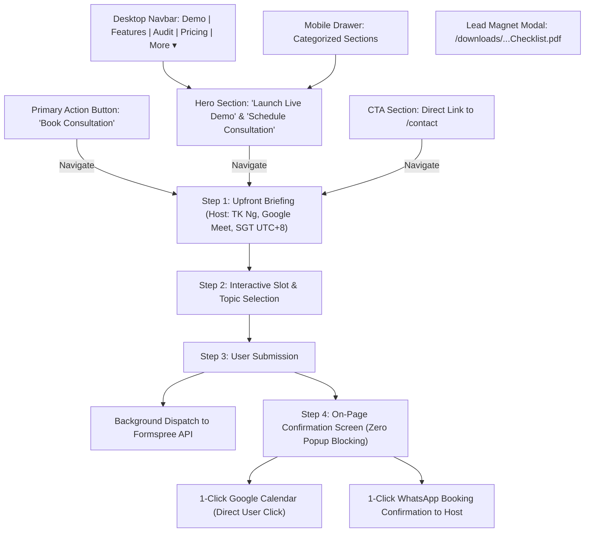

# Technical Design: KaoinAI Navigation, Link Integrity & Appointment UX Clarity

* **Author:** Antigravity (Pair Programming with User)
* **Date:** 2026-11-14
* **Status:** Approved & Sharpened (Ready for Implementation)

---

## 1. Overview

This design addresses usability, navigation clutter, dead links, and appointment flow ambiguity on the KaoinAI website (`kaoinai.com`). 

Currently, visitors encounter competing calls-to-action, broken download paths, dead-end `mailto:` links where an appointment scheduler was expected, and an appointment booking flow that triggers browser popup blocking. 

This document defines the architectural and user-experience solutions to:
1. Standardize direct consultation booking with the principal architect as the primary call-to-action across the website.
2. Validate and repair all internal route references, asset downloads, and call-to-action target paths.
3. Reduce top-level navigation clutter and organize hierarchies into structured groups.
4. Refactor the appointment scheduling flow on `/contact` with upfront briefing details, popup-free in-page confirmation, direct Google Calendar event generation, and 1-click WhatsApp confirmation.

---

## 2. Problem Statement

Inspection of the codebase (`I:\kaoinai-website`) identifies four concrete defects:

### 2.1 Dead and Mismatched Links
* **404 Download Link in Lead Magnet**: In [`src/components/LeadMagnetModal.tsx`](file:///I:/kaoinai-website/src/components/LeadMagnetModal.tsx#L117), the PDF download link targets `/2026-SME-Data-Governance-PDPA-Checklist.pdf`. The file exists only under `/downloads/2026-SME-Data-Governance-PDPA-Checklist.pdf`. When visitors submit the checklist request modal, clicking the download button returns an HTTP 404 error.
* **Mismatched "Book Live Demo" CTA Link**: In [`src/sections/CTA.tsx`](file:///I:/kaoinai-website/src/sections/CTA.tsx#L172), the button labeled "Book a 15-Minute Live Demo" opens a raw `mailto:sales@kaoinai.com` client instead of sending users to the dedicated scheduling system on [`/contact`](file:///I:/kaoinai-website/src/pages/Contact.tsx).
* **Orphaned Component Duplication**: [`src/sections/Resources.tsx`](file:///I:/kaoinai-website/src/sections/Resources.tsx) is unmounted in `App.tsx` and duplicates the functionality of [`src/sections/KnowledgeCenter.tsx`](file:///I:/kaoinai-website/src/sections/KnowledgeCenter.tsx), creating dead code and conflicting asset references.

### 2.2 Appointment Booking Flow Deficiencies & Popup Blocker Failures
* **Browser Popup Suppression in Try and Catch**: In [`src/pages/Contact.tsx`](file:///I:/kaoinai-website/src/pages/Contact.tsx#L298-L303), `window.open(gcalUrl, '_blank')` is triggered *after* an asynchronous `await fetch(...)` network request to Formspree on line 298 (and line 303 in `catch`). Standard browser security policies block programmatic popups originating outside direct user gestures. Consequently, when visitors submit the form, the calendar tab is blocked without clear feedback.
* **Pre-Booking Cognitive Ambiguity**: The appointment form does not clearly state:
  1. What happens after the button is clicked.
  2. How video conferencing links are provisioned (clarifying that this is a consultation request and TK Ng reviews and sends the formal calendar invitation with the meeting link).
  3. That all time slots are conducted in Singapore Time (SGT, UTC+8).

### 2.3 Navigation Overload & Competing Calls-to-Action
* **Navigation Fragmentation & Desktop Wrapping**: The desktop navbar packs 5 primary links, a "More" dropdown containing 6 additional links, an external WhatsApp pill, and a trial button. On 1024px–1280px viewports, this causes layout wrapping. The mobile drawer displays an uncurated list of 12 vertical links.
* **Call-to-Action Dilution**: The homepage simultaneously urges visitors to "Deploy 14-Day Pilot" (email form), "Launch Interactive Demo" (anchor jump), "Chat on WhatsApp" (messaging), "Book 1-on-1 Consultation" (calendar), and "Free Maturity Audit" (quiz tool). With five competing primary actions, users lack a clear default conversion path.

---

## 3. Goals & Non-Goals

### 3.1 In-Scope Goals
* **Standardize Consultation Booking as Primary Action**: Unify header CTAs, hero CTAs, and section footer links so that "Book Consultation" consistently directs visitors to `/contact`.
* **Validate and Repair Internal Route References & Downloads**:
  * Correct the download path in `LeadMagnetModal.tsx` (line 117) to `/downloads/2026-SME-Data-Governance-PDPA-Checklist.pdf`.
  * Reroute the CTA section demo booking link to `/contact`.
  * Delete orphaned component `src/sections/Resources.tsx`.
  * Ensure internal hash anchors scroll accurately with fixed header clearance.
* **Frictionless, Popup-Free Appointment Workflow**:
  * Eliminate asynchronous popup blockers by removing `window.open` from both lines 298 and 303 in `Contact.tsx`.
  * Transition smoothly to the existing on-page confirmation dashboard upon submission, allowing users to save to Google Calendar on direct click or confirm via WhatsApp.
  * Reframe the workflow as a **Priority Consultation Request**: TK Ng receives the request via Formspree and dispatches the formal calendar invitation with the direct Google Meet video link via email.
  * Add a visible on-screen alert if Formspree dispatch fails due to network or adblocker restrictions.
* **Streamline Navigation Structure**:
  * Desktop Header: 4 core links (`Live Demo`, `Features`, `Maturity Audit`, `Pricing`) + `More ▾` dropdown + WhatsApp shortcut (`WHATSAPP_DISPLAY`) + `Book Consultation` CTA button.
  * Retain `#audit` for in-page smooth scrolling on the homepage.
  * Refactor `Navigation.tsx` route handling to `const isLandingPage = location.pathname === '/'`, prefixing `/` to all hash links when on sub-routes.
  * Mobile Drawer: Structure into four categorized sections (`Platform`, `Enterprise & Trust`, `Knowledge`, `Direct Action`).

### 3.2 Non-Goals
* **No Custom Client-Side RFC 5545 `.ics` or Outlook Engine**: Per architectural review consensus, hand-rolling custom `.ics` serializers and Outlook deeplinks introduces spec violations and Microsoft 365 auth failures. The system will leverage the existing on-page confirmation view, direct Google Calendar link, and direct email dispatch from TK Ng.
* **No Third-Party Paid Scheduler Dependencies**: We will not introduce external paid iframe dependencies (e.g. Calendly, HubSpot Meetings) that require API subscriptions or track third-party cookies.
* **No Visual Identity / Palette Rebranding**: The established color scheme, typography, and styling tokens will be preserved.
* **No Alteration to Statutory Regulatory Content**: The core compliance messaging (PDPA, MAS TRM, RoPA, DPIA) remains intact.

---

## 4. Technical Plan

### 4.1 System Interaction & Conversion Architecture

The diagram below illustrates how navigation hierarchy, link validation, and appointment scheduling interact across the frontend application:



---

### 4.2 Component & Routing Specifications

#### 1. Global Navigation (`src/sections/Navigation.tsx`)
* **Desktop Structure**:
  * Brand Logo (redirects to top of `/`).
  * Primary links (4 items):
    1. `Live Demo` (`#demo`)
    2. `Features` (`#features`)
    3. `Maturity Audit` (`#audit`)
    4. `Pricing` (`#pricing`)
  * `More ▾` dropdown:
    1. `Product Tour UI` (`#product-tour`)
    2. `Engineering & Compliance Blog` (`/blog`)
    3. `Security & Trust Whitepaper` (`/security`)
    4. `Case Studies` (`#case-studies`)
    5. `Compare vs Legacy` (`#compare`)
    6. `FAQ` (`#faq`)
  * Action items:
    * WhatsApp direct link (referencing `WHATSAPP_NUMBER` / `WHATSAPP_DISPLAY` from `@/lib/whatsapp`).
    * Primary CTA Button: **"Book Consultation"** (navigating directly to `/contact`).
* **Route-Aware Hash Linking**:
  * Refactor `isContactPage` to:
    ```ts
    const isLandingPage = location.pathname === '/'
    ```
  * For all hash links, evaluate:
    ```ts
    href={!isLandingPage && link.href.startsWith('#') ? '/' + link.href : link.href}
    ```
* **Mobile Drawer**:
  * Grouped into four clear semantic sections:
    * **Platform**: Live Demo (`#demo`), Features (`#features`), Maturity Audit (`#audit`), Pricing (`#pricing`)
    * **Enterprise & Trust**: Security & Trust (`/security`), Case Studies (`#case-studies`), Comparison (`#compare`)
    * **Knowledge**: Engineering Blog (`/blog`), FAQ (`#faq`)
    * **Direct Action**: Full-width "Book Consultation" button (`/contact`) + WhatsApp button.

#### 2. Call-to-Action Section (`src/sections/CTA.tsx`)
* Replace the `mailto:sales@kaoinai.com` link on line 172 with a React Router `<Link to="/contact">` styled as a secondary action button with calendar icon: "Schedule 1-on-1 Consultation with TK Ng".

#### 3. Lead Magnet Modal (`src/components/LeadMagnetModal.tsx`)
* Update the file URL in line 117 to `/downloads/2026-SME-Data-Governance-PDPA-Checklist.pdf`.

#### 4. Decommissioning Orphaned Files
* Delete [`src/sections/Resources.tsx`](file:///I:/kaoinai-website/src/sections/Resources.tsx).

---

### 4.3 Appointment Scheduling Component (`src/pages/Contact.tsx`)

#### Elimination of Popup Suppression
* Remove `window.open(gcalUrl, '_blank', ...)` from both line 298 (`try` block) and line 303 (`catch` block) in `handleBookingSubmit`.
* Upon submitting the form:
  1. Dispatch Formspree submission asynchronously via `fetch`.
  2. If network request fails or is blocked by adblockers, set `hasSubmissionWarning = true` in state.
  3. Transition UI immediately to `bookingConfirmed = true`.
  4. Scroll smoothly to the confirmation panel.

#### Pre-Booking Briefing Banner
Above the date and slot selectors, display an informational briefing:
1. **Host**: TK Ng, Principal AI & Data Governance Architect (direct host, no sales qualification screening).
2. **Platform & Process**: Priority Consultation Request. TK Ng reviews your submission and dispatches the confirmed calendar invitation with the direct Google Meet video link to your email.
3. **Timezone**: All slots are conducted in Singapore Time (SGT, UTC+8). Calendar invites adjust automatically to your calendar's local timezone.

#### On-Page Confirmation Dashboard
* Retain the existing, styled confirmation view with:
  * Booking Reference ID (`bookingRefId`) with 1-click copy button.
  * Summary grid (Host, Duration, SGT Date/Time, Attendee, Topic).
  * Direct user-click button: **"Open & Save in Google Calendar"** (bypasses popup blockers).
  * Direct user-click button: **"Send 1-Click WhatsApp Confirmation to TK"**.
  * If `hasSubmissionWarning` is true, render a prominent warning banner:
    *"Notice: Automated network notification was blocked by your browser or adblocker. Please use the WhatsApp confirmation button or email tk.ng@kaoinai.com directly with your Reference ID to ensure your booking is logged."*

---

## 5. Alternatives Considered

### 5.1 Alternative A: Custom Client-Side RFC 5545 `.ics` & Outlook Generator
* **Description**: Hand-roll custom `.ics` file generation and Outlook Web deeplinks in TypeScript.
* **Why Rejected**: Evaluated during review and rejected due to RFC 5545 specification violations (`METHOD:REQUEST` without attendee, lack of line folding), failure on corporate Microsoft 365 accounts (`outlook.live.com` consumer auth rejection), and excessive frontend maintenance overhead. The existing confirmation dashboard with direct Google Calendar button and host email dispatch solves the user need cleanly.

### 5.2 Alternative B: Third-Party Hosted Scheduling Widget (Calendly / Cal.com / HubSpot)
* **Description**: Embed an external scheduling iframe inside `/contact`.
* **Why Rejected**: Introduces third-party tracking cookies (contradicting zero-retention compliance optics), iframe layout shift on mobile, and recurring subscription overhead.

### 5.3 Alternative C: Direct Browser Tab Hijack / Force Redirect
* **Description**: Replace the current browser window (`window.location.href = gcalUrl`) upon form submission.
* **Why Rejected**: Forcibly ejects the visitor from KaoinAI before they can record their reference ID or confirm their submission state.

### 5.4 Alternative D: Full-Width Desktop Mega-Menu
* **Description**: Expand navbar dropdown into a multi-column directory detailing all 17 page sections.
* **Why Rejected**: Overwhelms visitors with cognitive clutter. A lean, intent-driven navbar directs attention to the interactive demo and appointment scheduling.

---

## 6. Detailed Implementation Plan

### 6.1 Enumeration of Affected Files

| File Path | Operation | Rationale |
| :--- | :--- | :--- |
| [`src/components/LeadMagnetModal.tsx`](file:///I:/kaoinai-website/src/components/LeadMagnetModal.tsx) | Modify | Fix broken 404 download link by pointing `href` to `/downloads/2026-SME-Data-Governance-PDPA-Checklist.pdf` (line 117). |
| [`src/sections/CTA.tsx`](file:///I:/kaoinai-website/src/sections/CTA.tsx) | Modify | Replace `mailto:sales@kaoinai.com` anchor (line 172) with a React Router `<Link to="/contact">`. |
| [`src/sections/Navigation.tsx`](file:///I:/kaoinai-website/src/sections/Navigation.tsx) | Modify | Reorganize desktop navbar to 4 primary links + `More ▾`, update CTA button to "Book Consultation" (replacing "Deploy 14-Day Pilot"), refactor `isLandingPage` route handling, and group mobile drawer links. |
| [`src/pages/Contact.tsx`](file:///I:/kaoinai-website/src/pages/Contact.tsx) | Modify | Add briefing banner, remove `window.open` from lines 298 and 303, add on-screen warning banner for Formspree dispatch failure, and reframe as Priority Consultation Request. |
| [`src/sections/Resources.tsx`](file:///I:/kaoinai-website/src/sections/Resources.tsx) | Delete | Remove unmounted component duplicating `KnowledgeCenter.tsx`. |

---

### 6.2 Step-by-Step Implementation Sequence

#### Step 1: Repair Broken Links and Remove Orphaned Component
1. In [`src/components/LeadMagnetModal.tsx`](file:///I:/kaoinai-website/src/components/LeadMagnetModal.tsx#L117), update `href` from `/2026-SME-Data-Governance-PDPA-Checklist.pdf` to `/downloads/2026-SME-Data-Governance-PDPA-Checklist.pdf`.
2. In [`src/sections/CTA.tsx`](file:///I:/kaoinai-website/src/sections/CTA.tsx#L171-L178), replace the raw `mailto:` anchor with `<Link to="/contact">` labeled "Schedule 1-on-1 Consultation with TK Ng".
3. Delete [`src/sections/Resources.tsx`](file:///I:/kaoinai-website/src/sections/Resources.tsx).

#### Step 2: Overhaul Global Navigation Architecture
1. In [`src/sections/Navigation.tsx`](file:///I:/kaoinai-website/src/sections/Navigation.tsx):
   * Configure primary desktop links to: `Live Demo` (`#demo`), `Features` (`#features`), `Maturity Audit` (`#audit`), and `Pricing` (`#pricing`).
   * Configure `More ▾` dropdown items to: `Product Tour UI` (`#product-tour`), `Engineering Blog` (`/blog`), `Security & Trust Whitepaper` (`/security`), `Case Studies` (`#case-studies`), `Compare vs Legacy` (`#compare`), and `FAQ` (`#faq`).
   * Replace the `"Deploy 14-Day Pilot"` button (lines 324 and 383) with `"Book Consultation"` (`to="/contact"`).
   * Refactor route prefixing: replace `isContactPage` with `const isLandingPage = location.pathname === '/'`. For all hash links, evaluate `!isLandingPage && href.startsWith('#') ? '/' + href : href`.
   * Restructure `allMobileNavLinks` into a categorized data structure:
     ```ts
     const mobileNavCategories = [
       {
         category: 'Platform',
         items: [
           { label: 'Live Demo', href: '#demo' },
           { label: 'Features', href: '#features' },
           { label: 'Maturity Audit', href: '#audit' },
           { label: 'Pricing', href: '#pricing' },
         ],
       },
       {
         category: 'Enterprise & Trust',
         items: [
           { label: 'Security & Trust Whitepaper', href: '/security' },
           { label: 'Case Studies', href: '#case-studies' },
           { label: 'Compare vs Legacy', href: '#compare' },
         ],
       },
       {
         category: 'Knowledge',
         items: [
           { label: 'Engineering Blog', href: '/blog' },
           { label: 'FAQ', href: '#faq' },
         ],
       },
     ]
     ```

#### Step 3: Refactor the Appointment Booking Flow on `/contact`
1. In [`src/pages/Contact.tsx`](file:///I:/kaoinai-website/src/pages/Contact.tsx):
   * Insert a briefing banner above the date/slot selection:
     * Direct Architecture Host: TK Ng (`tk.ng@kaoinai.com`)
     * Priority Consultation Request: Slot is reserved and TK Ng emails the confirmed Google Meet link.
     * Timezone: Singapore Time (SGT, UTC+8).
   * In `handleBookingSubmit`:
     * Remove `window.open` from line 298 (`try` block) and line 303 (`catch` block).
     * Add `const [submissionError, setSubmissionError] = useState(false)`. In the `catch` block of the Formspree fetch, set `setSubmissionError(true)`.
     * Ensure `setBookingConfirmed(true)` transitions to the existing confirmation screen smoothly.
   * On the confirmation screen (`bookingConfirmed === true`):
     * If `submissionError` is true, render an alert banner: *"Notification could not be dispatched automatically due to network/adblocker restrictions. Please confirm via WhatsApp or email tk.ng@kaoinai.com."*
     * Retain the direct user-click button "Open & Save in Google Calendar" and the 1-click WhatsApp button.

#### Step 4: Verification & Quality Gates
1. Run `npm run lint` and `npm run build` to ensure zero compilation or lint errors.
2. Verify all internal hash anchors scroll accurately with fixed navbar clearance.
3. Verify download functionality of `/downloads/2026-SME-Data-Governance-PDPA-Checklist.pdf` from the Lead Magnet modal.
4. Verify appointment booking flow:
   * Slot selection and briefing display.
   * Form submission without browser popup blocker suppression.
   * Confirmation dashboard display with booking reference and Google Calendar link.
   * Error state fallback when offline.
